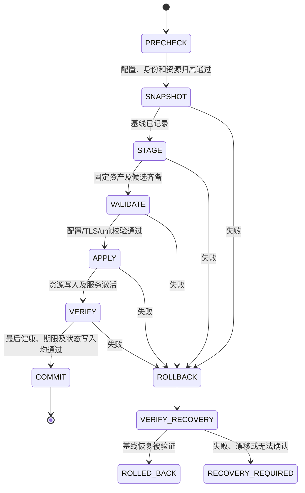

> Historical baseline; later repairs may supersede findings below. Use [current tasks](../TASKS.md) and verify source before acting. This record is not execution or commit authorization.

# PNM 部署事务与恢复设计

日期：2026-10-22。基线：`7a8dfe134f0c07e7ba16d740eb0e3c54db53b9ec` / `0.16.0-rc.1`。

**状态：A 方案已用于用户要求继续的 G-02 工作，当前工作树已有实现及本地验证；Linux/systemd 验收未完成。** 本文保留原设计目标，以下第 0 节记录实际范围和差异。[实现评估 A-01/A-02/A-05](IMPLEMENTATION_ASSESSMENT.md) 是实施前证据；当前状态见 [TASKS.md](../TASKS.md)，决策见 [D-008](../DECISIONS.md)。本文不授权生产执行或发布。

## 0. 2026-10-23 工作树实现范围

- S1～S4 的本地主链路已落地：schema-2 元数据/目录收据、显式部署参与者、外层最终提交、依赖顺序补偿及未决事务读取保护。S5 的独立 restart/update/rollback 证据维护及端口问题仍待处理。
- 公共部署由 gate 最后调用 `pnm_deploy_finish`，组件不能独立提交。内部无 gate 的协调器包装仍可自行结束事务，保留既有独立测试/调用兼容；它不是新的宿主部署入口。
- 只有 `operation=deployment` 使用资源绑定的权威 marker；其他 schema-2 操作保留既有 journal 提交规则。schema-1 保留检查能力，不自动迁移恢复。
- 发布 marker 前先持久化 `commit-uncertain.env`。资源、快照及 marker 同步完成后才移除未确认记录。同步失败或进程在发布中终止时，已存在的未确认记录使后续写入和受保护读取拒绝继续。已持久提交后的派生日志失败只警告。
- 文件/目录按首次变更前逐项快照，不提供全资源物理原子切换；同一部署重复发布同一目标仍拒绝，当前主链路每个文件只发布一次。没有引入任意嵌套或多次写入合并框架。
- 宿主复用既有自签名 TLS 时，属主规范化前将原证书/密钥按相同字节登记并写入事务，保留原 UID/GID/mode 的恢复依据，不轮换证书或密钥。
- 宿主已有 Core 文件必须能匹配受保护的 PNM 失败安装收据及当前摘要/权限；loaded unit 还核验有效路径和无 drop-in。不能用同名服务或开放端口证明归属。归属表显式指定 IFS，回归覆盖真实 CLI 的换行/制表符 IFS。
- 恢复分别验证原 load/active/enabled，允许 active、disabled 基线。旧 applied 仅在此前 confirmed、恢复配置摘要及旧记录摘要/元数据均吻合时，原子写入经验证的新 InvocationID 并同步/读回；外部改动不覆盖，未知证据不提升为 confirmed。
- root `check`、`node show`、links 使用共享锁及未决检测。非 root `check` 保留诊断并报告 UNKNOWN，不声称配置/运行就绪；show/links 在锁前返回权限错误，links help 保持可用。
- INT/TERM/EXIT 尝试进程内补偿；本地覆盖了 TERM、丢失进程上下文及 marker 发布中子进程退出。未实现跨进程自动回放，不宣称 SIGKILL、断电、reboot 或真实 systemd 已验收。完整结果与证据路径见 TASKS。

## 1. 功能概述与目标

一次首次部署成功，表示此次操作涉及的双 Core 资源、服务状态、applied 记录和 `PNM_CONFIGURED=yes` 属于同一个已验证提交。提交前任何错误都应进入补偿，并验证恢复结果；不能只恢复 active/enabled 后宣称完整回滚。

部署是可补偿的多资源操作，不承诺多个文件或进程同时发生物理原子切换。保证的是单一逻辑提交边界、清晰可检查的恢复记录，以及失败时不把混合状态报告为成功。

约束：保留既有 CLI、配置和 URI 格式；双 Core 独立运行；单 Core apply/update/restart/rollback 仅影响目标 Core。整次首次部署才覆盖它实际改变的双 Core 资源。保留有效凭据，不接管不明资源，不修改 SSH/Tailscale/UFW/云防火墙。

## 2. 当前实现与方案对比

实施前业务链由源码直接追踪：`pnm_install → pnm_deploy_apply → pnm_apply_gate_execute → pnm_deploy_execute → sandbox/lifecycle/mark_configured`。当时 `pnm_tx_begin` 同时只允许一个全局事务；子步骤各自提交导致外层无法整体补偿。当前实现沿用该调用链并修复提交边界，见第 0 节。

| 方案 | 优点 | 缺点与风险 | 判断 |
|---|---|---|---|
| A：部署拥有一个现有事务，组件作为不提交的步骤参与 | 一个快照集合和提交点；最容易明确最后检查及补偿顺序；沿用 transaction.sh | 需要拆开组件“步骤”和“事务包装”，扩展元数据及读取校验 | 推荐 |
| B：保留所有子事务，失败时逆序补偿已提交事务 | 组件入口改动相对少 | 要跨已提交状态重放、关联依赖和冲突处理，增加恢复协议复杂度；两 Core 共享全局生命周期变量容易串用 | 不推荐作为本次最小修复 |
| C：整套 generation 目录与指针切换 | 文件版本集合便于切换 | 现有固定路径、unit、账户和 systemd 状态仍需补偿；迁移范围大 | 延后 |

## 3. 模块职责和关键接口

以下是原设计的内部契约；当前实现范围、兼容包装及差异以第 0 节和源码为准。复用现有模块，不创建第二套事务框架。

| 模块 / 现有入口 | 设计职责 | 提交权限 |
|---|---|---|
| `install.sh` / `pnm_install` | 参数、展示预检、既有 root/yes 入口 | 无 |
| `apply-gate.sh` / `pnm_apply_gate_execute` | 持有全局锁，管理期限，组织最终验证和事务终结 | 唯一外层拥有者调用一次 `pnm_tx_commit` |
| `deploy.sh` / `pnm_deploy_execute` | 顺序组织资源准备、激活、验证、node/applied 状态暂存及写入 | 作为参与者不再独立提交 |
| `sandbox-install.sh` 的现有 step 函数 | 资产、Secret、TLS、配置和 unit 操作；所有变更通过同一事务登记 | 参与者不 begin/commit/close |
| `lifecycle.sh` 的现有 step 函数 | 对指定 Core reload/enable/start/health，使用该 Core 独立基线 | 参与者不 begin/commit/close |
| `transaction.sh` | 快照、写入意图、补偿、恢复验证、唯一权威提交证据 | 不提供任意嵌套事务 |
| `accounts.sh` / `lock.sh` | 当前操作所建身份的收据、依赖顺序；已有重入锁 | 不创建独立部署提交点 |

保留 `pnm_sandbox_install`、`pnm_core_lifecycle_apply` 等现有独立包装入口；需要单独调用时仍拥有自己的事务。部署直接组合抽出的内部步骤。不要通过“如果发现任意活动事务就自动加入”隐式共享上下文，应显式检查操作名和部署 ID，错误上下文立即失败。

事务拥有者负责 begin/commit/rollback/close 和锁释放；参与者只返回错误。`pnm_tx_run` 当前可能立即回滚，应使部署参与路径将失败交回拥有者，避免两次恢复。独立命令保留自身失败补偿语义。

## 4. 核心数据结构与资源清单

使用现有 `/var/lib/pnm/transactions/<id>/` 保存权威状态，deployment/apply 目录仅保留关联和可重建的进度记录。继续使用受保护目录 0700、记录及快照文件 0600；配置数据仍用显式解析器，禁止 source/eval 恢复记录。

| 记录 | 拟议内容与约束 |
|---|---|
| 事务 metadata | schema、operation、transaction/deployment/apply ID；只允许合法字符、固定键 |
| 文件快照与变更清单 | 路径、标签、存在性、原内容快照、mode、数字 UID/GID、写入后摘要及元数据；路径严格校验 |
| 目录记录 | 是否预先存在、原 mode/UID/GID、是否本次创建；不递归快照共享目录 |
| Core 服务基线 | 每个 Core 独立记录 unit 是否存在、原 active/enabled、unit 路径和有效配置识别信息；未知状态在变更前拒绝 |
| 账户收据 | 原先存在与本次创建区分，INTENT/APPLIED/RESTORED；身份冲突不自动修正 |
| journal | 阶段、错误、补偿及验证事实；只存脱敏字段 |
| 提交证据 | 唯一事务终态，绑定本次资源集合；见第 6 节 |

当前 schema=1 的快照仅有 mode，不能静默当作带 UID/GID 的新格式。建议引入严格的 schema=2 事务记录：保留旧记录只读检查能力；仅新记录可执行本设计的完整恢复。旧记录信息不足时报告恢复限制，不伪造元数据、不猜测后自动 chown。metadata、manifest、snapshot.state、账户和多 Core 状态的读取器一起升级；未知版本拒绝写操作。

每个目标路径只保存一次操作前基线。一个部署中再次写同一文件时只更新最后一次写入收据，不能覆盖初始快照或生成互相冲突的标签；恢复时以最后写入值检查漂移，再恢复初始基线。目录在任何 chmod/chown 之前也只记录一次。这对 applied 记录多次更新和恢复验证尤其重要。

资源覆盖清单：

| 资源 | 成功状态 | 失败恢复要求 |
|---|---|---|
| 两 Core binary | 固定版本、校验通过、正确执行位 | 原内容和元数据；原先缺失则仅删除本次文件 |
| runtime config / unit | 候选已验证、策略权限正确 | 原内容、存在性、UID/GID/mode；恢复后 daemon-reload |
| `reality.env` / `hysteria.env` | 缺失才生成；有效已有凭据保持稳定 | 原文件保持；仅删除本次生成且未漂移的文件 |
| HY2 TLS | 证书/密钥配对、SNI/pin/有效期/账户访问验证 | 原内容、存在性、属主和权限 |
| `node.conf` / applied 记录 | 最终验证后写入 configured=yes 和有效运行证据 | node 恢复原值；applied 按恢复后的实际进程重新确认 |
| 目录 | 保留共享目录原策略，仅调整明确管理的资源 | 既有目录恢复元数据；新建空目录逆序 rmdir |
| 账户 / 组 | 有效既有账户复用，本次创建有收据 | 保留既有账户；仅删本次创建且依赖已解除的身份 |
| 服务 active/enabled | 两 Core 均通过本地健康门控 | 恢复原策略；原 unit 不存在时恢复缺失，而非对已删除 unit 继续调用 disable |
| 资产缓存 / 审计记录 | 允许保留验证过的缓存及审计 | 缓存不作为已应用状态；恢复证据必须保留 |

`versions.conf` 在首次部署中是输入；未改动不需要恢复。未来任何路径若写它，也必须先登记快照。本设计不触碰 `/etc/passwd` 等共享文件整体快照，避免覆盖其他操作者变更。

## 5. 处理流程与状态机

1. **PRECHECK**：参数及外层只读预检。取得全局锁后重验配置、实际端口、资源归属和未决恢复记录；防止预检与写入之间状态改变。缺工具、未知账户/unit/监听者在管理资源变更前失败。受保护的审计/锁目录允许创建，但不能宣称绝对零文件写入。
2. **SNAPSHOT**：先记录原 unit 存在性、每 Core 服务基线，以及所有拟改文件和目录的存在性、元数据；无可靠快照不允许覆盖。必须在 prepare_dirs/chown 前完成。
3. **STAGE**：下载校验固定资产，生成缺失 Secret，在事务目录准备候选。需账户才能做访问检查时，先写创建意图再创建，登记补偿；仍不得提交。
4. **VALIDATE**：真实 Xray 候选检查、HY2 候选/TLS/SNI/pin 校验、unit 校验、资产版本检查。静态校验和激活后的服务账户读取检查分别记录。
5. **APPLY**：按资源清单发布，逐项登记写入意图和结果；运行服务前完成权限设置。仅操作本次资源集合。
6. **VERIFY**：验证两 Core 服务、对应 TCP/UDP 监听、运行配置、权限、TLS 与实际读取；执行外层 deadline 检查。在同一事务内写 applied 记录和 `configured=yes`，再复核摘要/InvocationID 稳定性及期限。
7. **COMMIT**：通过唯一权威事务提交后才输出成功。部署日志、gate 收据、资源事务不得分别拥有可冲突的成功判据。

既有 `install --dry-run` 保持只读预检和计划语义，不开始写事务、不下载资产、不生成 Secret、不创建部署状态目录；不能通过调用真实参与步骤后再“假回滚”实现预览。

安全路径检查必须覆盖 root/sandbox 下所有祖先组件，并位于 mkdir/chmod/chown/write 之前。原 root `/` 及别名只能用作宿主路径标识，不能 chmod。候选文件应在目标目录原子 rename，并在可见前设置最终权限/属主；该操作不等于整个部署原子切换。

## 6. 唯一提交判据与错误处理

仅延迟一个 `pnm_tx_commit` 仍不足以解决现有 journal、deployment COMMIT、gate `commit.env` 的多重判定。建议 schema=2 在**同一事务目录**内采用一个权威 `commit.env`；这是现有事务终态扩展，不是另一个状态库。

拟议提交步骤：所有业务验证、期限检查及必要记录先完成 → journal 写 `COMMIT_INTENT` → 在事务目录安全临时文件中生成绑定事务 ID 与最终资源清单摘要的提交记录 → 刷盘并原子 rename 为 `commit.env` → 同步父目录 → 设置内存 COMMITTED。可使用现有 Python 依赖的 `os.fsync`，不得引入另一个守护进程。journal 的完成事件及旧 deployment/gate 收据变为派生信息；读取器对 schema=1 保留旧规则，对 schema=2 仅按有效 marker 判断提交。

| 情况 | 必须行为 |
|---|---|
| 最后验证、期限或 marker 发布前失败 | 不生成有效 marker，统一回滚并验证 |
| marker 已有效持久化，进度日志/派生收据/清理失败 | 报告已提交及脱敏警告；返回业务成功，不错误宣称未提交或执行部署回滚 |
| marker 发布后持久化失败，或 marker/清单冲突 | 返回非零及 RECOVERY_REQUIRED，保留证据；禁止自动盲目重试/回滚；先核对持久化和实际资源 |
| 原操作失败且恢复也失败 | 非零；同时保留 original_rc、recovery_rc、阶段、事务 ID 和证据路径 |
| 同一资源当前内容/元数据不再匹配本次写入记录 | 认定外部漂移，停止覆盖该资源，留下恢复要求 |

默认保留既有公开错误码体系：参数 64、缺工具/环境 69、恢复或软件异常 70、写入失败 73、权限 77、配置/健康 78。正常补偿完成可返回原错误码；补偿失败返回 70，并在脱敏诊断保留原错误。派生日志失败不把已经提交的业务变为普通失败。

未承诺跨文件系统断电原子性。文件系统、fsync 和存储行为需隔离验证；SIGKILL/reboot 后必须依据磁盘记录重建状态，不能信任进程内标志。若耐久性无法确认，保持恢复要求。

## 7. 回滚与恢复验证

建议顺序体现资源依赖，而不是直接把现有回调列表倒序运行：

1. 停止本次激活/替换且归属已确认的服务，防止读取正在恢复的文件。
2. 逐项核对当前文件摘要及元数据仍符合本次收据；逆序恢复文件。属主恢复先于最终 mode，避免 chown 改变特殊权限位。
3. 恢复 unit 后 daemon-reload，恢复 enable 策略；只重启原本 active 且受本次影响的 Core，原本 inactive 的保持停止。
4. 验证旧配置及实际运行进程。若恢复导致 InvocationID 变化，基于已经确认的旧配置重建对应 applied 记录；若原基线没有有效 applied 证据，保持未知，不能制造 confirmed。
5. 删除本次创建且已经无服务/文件依赖的账户与组；失败时保留收据，不误删既有身份。恢复既有目录元数据，新建目录只在空且归属可证明时删除。
6. **VERIFY RECOVERY**：逐项检查存在性、内容、UID/GID/mode、服务状态、必要监听和凭据稳定性；忽略 PID、InvocationID 这类必然变化的运行身份，只检查其与新确认记录一致。无有效提交 marker且所有恢复断言通过，才写 ROLLED_BACK。

回滚不是“重装旧版本”，不得重新生成旧 Secret，也不得重写未经本次修改的另一 Core。

进程内 INT/TERM 应交给唯一拥有者尝试上述补偿并正确释放锁；EXIT cleanup 不能删除未完成恢复证据。SIGKILL 无法捕获，后续写操作必须识别未终结事务并阻止覆盖；不自动按旧 shell 回调名执行任意恢复操作。首个修复版本至少提供受控人工恢复材料及未决状态识别；自动跨进程恢复命令另行批准。在该能力验证前不得宣称自动抗崩溃恢复。

## 8. 跨模块依赖、兼容与实施切片

| 切片 | 范围 | 验收条件 |
|---|---|---|
| S1 安全基础 | transaction/common/sandbox 的元数据快照、目录处理、祖先路径校验及严格解析 | A-02/A-05 用例通过；schema=1 只读兼容，未知 schema 拒绝变更 |
| S2 组件步骤 | sandbox/lifecycle 将步骤与独立事务包装分开；多 Core 基线不得共享覆盖 | 既有独立命令行为稳定，参与者无私自 commit/close |
| S3 唯一拥有者 | apply-gate/deploy/transaction 统一终结；状态和 applied 写入处于同一恢复边界 | 覆盖外层期限/再次健康/最终 marker 失败；无部分成功 |
| S4 恢复与读取 | 反向依赖恢复、恢复验证、未决事务检测；node/links 等一致性敏感读取使用共享锁或拒绝未决状态 | 不能在部署中读到未提交的候选并输出可用链接；损坏记录不执行 |
| S5 生命周期与配置兼容 | A-03 配置端口；A-04 PNM 控制重启后的证据及恢复证据 | 单 Core 隔离、端口和链接矩阵通过 |

共享读锁应失败快返或复用既有错误码，不能让普通 status 无期限等待；保留既有 JSON schema 字段语义，新增字段须显式兼容评审。普通运行态重启产生新身份后不能用旧 applied 记录“看上去一致”。

关键源文件清单：[apply-gate.sh](../../lib/apply-gate.sh)、[deploy.sh](../../lib/deploy.sh)、[transaction.sh](../../lib/transaction.sh)、[lock.sh](../../lib/lock.sh)、[sandbox-install.sh](../../lib/sandbox-install.sh)、[lifecycle.sh](../../lib/lifecycle.sh)、[accounts.sh](../../lib/accounts.sh)、[core-ops.sh](../../lib/core-ops.sh)、[render.sh](../../lib/render.sh)、[preflight.sh](../../lib/preflight.sh)、[check.sh](../../lib/check.sh)。

## 9. 决策逻辑与退出条件

已采用 A 方案及 S1～S4 的主流程实现，S5 和真实 Linux 验收仍开放。schema/marker 兼容范围、已提交后的警告语义、旧记录只读和外部重启不自动提升证据的实际策略见第 0 节；不能将原设计目标全部视为完成。

完成条件见 [ACCEPTANCE_PLAN.md](../ACCEPTANCE_PLAN.md)：先通过 mock 和安全基础测试，再做隔离 Linux/systemd 故障注入及 reboot 验收，外部双协议连接单独记录。任何层次未执行，保留未验证状态。
