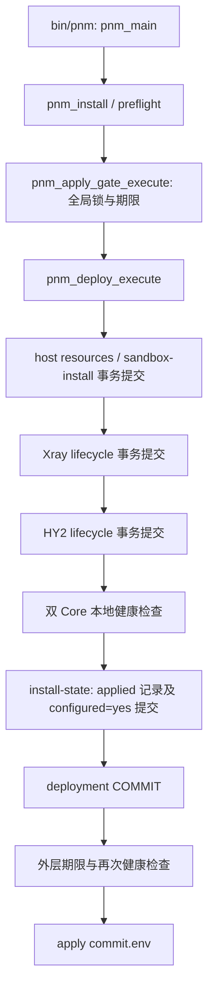

> Historical baseline; later repairs may supersede findings below. Use [current tasks](../TASKS.md) and verify source before acting. This record is not execution or commit authorization.

# PNM 当前实现与目标差距评估

评估日期：2026-10-22。源码基线：`dev` / `7a8dfe134f0c07e7ba16d740eb0e3c54db53b9ec`，`VERSION=0.16.0-rc.1`。

本页保留实施前评估。后续工作树已完成 S1 安全基础、主流程测试修复和 G-02 本地实现；最新证据及仍开放的验收见 [TASKS.md](../TASKS.md)，不要将下文基线缺口直接当作当前未修复状态。

## 1. 结论与评估口径

PNM 已具备单 VPS 双 Core 管理工具的主要业务链路：节点初始化、固定版本资产安装、配置生成、独立服务操作、本地健康检查、分享链接、备份恢复和事务记录。现有 Bash 模块及 Linux adapters 与“轻量管理面、不转发流量”的目标一致，没有依据要求重写语言或引入新的服务框架。

当前不足集中在**部署整体恢复一致性、文件元数据恢复和运行证据维护**。建议继续 Phase 3，先解决这些问题并完成隔离 Linux 验收，再讨论 Profiles。不能据此基线宣称生产就绪，也不能把历史审计中的所有缺陷继续视为当前未修复。

目标采用 [ARCHITECTURE.md](../ARCHITECTURE.md)、[ROADMAP.md](../ROADMAP.md)、[DECISIONS.md](../DECISIONS.md) 和根目录 [AGENTS.md](../../AGENTS.md)。[PHASE2_GAP_ANALYSIS.md](PHASE2_GAP_ANALYSIS.md) 保留历史问题 ID；下文重新核对源码，不改写历史报告。

| 标记 | 含义 |
|---|---|
| 已实现 | 当前源码存在相应分支和调用链 |
| 有测试代码 | 找到相关断言；不代表本轮执行成功 |
| 静态确认 | 从当前实现直接可见的事实或缺口 |
| 推导风险 | 依赖系统行为或故障触发，需要运行复现 |
| 待验收 / 阻塞 | 缺少本轮可复核的目标环境证据 |
| 设计提案 | 本次设计产物；未修改实现，未授权部署 |

范围内检查了 CLI、配置、安装、部署、事务、生命周期、检查、链接、更新、恢复及相关测试。未做完整逐函数安全审计、性能测试或远端源码身份核验。统计 `bin/`、`lib/`、`adapters/` 共 27 个运行源码文件、6689 行；`tests/unit/` 有 19 个测试文件、169 处 `run_test` 注册语句。上述是文件统计，不是测试通过数。

## 2. 实现与目标对照

| 目标 / 场景 | 当前实现和关键入口 | 当前判断 | 尚需证明 |
|---|---|---|---|
| 稳定的 `pnm` CLI | [bin/pnm](../../bin/pnm) → `pnm_main`；[common.sh](../../lib/common.sh)、[output.sh](../../lib/output.sh) 路由及帮助 | 已实现；保留既有命令 | 兼容脚本和错误码回归 |
| 单节点期望状态 | [node.sh](../../lib/node.sh) `pnm_node_init`；[config.sh](../../lib/config.sh) 白名单解析和校验 | 已实现；node/version 文件事务写入，配置数据不作为 shell 执行 | Linux 权限、初始化故障和重试 |
| 双 Core 独立运行 | [service.sh](../../lib/service.sh)、[lifecycle.sh](../../lib/lifecycle.sh)、[core-ops.sh](../../lib/core-ops.sh) | 已实现；独立用户、unit、配置、单 Core 操作 | 对目标 Core 操作时另一 Core 保持可用 |
| 固定资产与摘要验证 | [host-apply.sh](../../lib/host-apply.sh)、[assets adapter](../../adapters/assets.sh) | 已实现；按 `versions.conf` 固定版本和 SHA-256 | 下载异常、缓存损坏、版本不符和恶意归档 |
| 首次凭据生成与重试稳定 | [sandbox-install.sh](../../lib/sandbox-install.sh) `prepare_secrets` / `generate_missing_secrets` | 已实现；缺失才生成、有效则复用、损坏则拒绝替换；有测试代码 | 真实 OpenSSL/Xray 组合、失败后 Secret 恢复 |
| Xray 公钥输出兼容 | [node.sh](../../lib/node.sh) `pnm_node_xray_reality_public_key` | 已支持 `Password (PublicKey)`、`Password`、`Public key`、`PublicKey` 分支 | 固定版本真实二进制测试；不能沿用旧解析器缺陷结论 |
| HY2 TLS / SNI 独立 | [tls.sh](../../lib/tls.sh)、[render.sh](../../lib/render.sh) | 已实现独立名称、证书校验、自签 pin 和外部证书路径 | 真实客户端验证、服务账户访问及异常权限 |
| 安装健康后提交 | [deploy.sh](../../lib/deploy.sh) `pnm_deploy_health_step` → [check.sh](../../lib/check.sh) `pnm_check_deploy_core_health` | 已检查服务、TCP/UDP 监听、配置、权限及 HY2 TLS；整体补偿仍不完整 | 任意阶段失败后的全资源一致性 |
| Desired / Persisted / Applied / Runtime | [render.sh](../../lib/render.sh) `pnm_node_core_link_status`、`pnm_core_applied_config_status`；[node.sh](../../lib/node.sh) show/links | 已区分文件一致性、服务状态、摘要和 InvocationID；两 Core 均有运行态输出 | 重启、更新、回滚及 reboot 后证据维护，见 A-04 |
| 单 Core 更新/回滚 | [core-ops.sh](../../lib/core-ops.sh) `pnm_core_update` / `pnm_core_publish_previous_state` / `pnm_core_rollback` | 当前 binary、previous binary 和 previous.env 已进入同一事务；历史 G-03 原缺口已有实现处理 | 元数据发布和补偿失败的完整矩阵 |
| 备份与恢复 | [core-ops.sh](../../lib/core-ops.sh) `pnm_core_backup` / `pnm_core_restore` | 有敏感归档权限、成员白名单、隔离解包、候选校验、恢复后健康检查 | 元数据/目录恢复、可信备份边界、故障和资源上限测试 |
| 依赖预检 | [preflight.sh](../../lib/preflight.sh) `pnm_preflight_runtime` | 包括 unzip/python3/openssl/systemd-analyze/账户工具/runuser；有缺工具测试 | 实际执行与补偿命令清单完整性；自定义端口见 A-03 |
| 管理面边界 | 正常安装流程、[security scan](../../tests/security-scan.sh)、[release scan](../../tests/release-scan.sh) | 保持 SSH/Tailscale/UFW/云防火墙边界 | 隔离 VM 前后差异核查 |
| Profiles / 资源指标 / 外部探测 | 现有路由和状态 schema 未实现对应目标；当前安装仍按双 Core 执行 | 规划；不视为 Phase 3 缺陷修复范围 | 另行批准需求、状态语义和接口 |
| 备份加密 / PNM 自更新 | 当前备份是敏感归档；Core update 不等于 PNM 自更新 | 延后；无充分依据扩大本次范围 | 密钥托管、恢复需求及发布模型 |

## 3. 核心业务调用链与提交边界

调用链由源码直接追踪，未运行 C++ 专用调用图工具。

关键依赖为 `install → preflight/deploy → apply-gate → host-apply/sandbox/lifecycle → transaction/lock/adapters`；`node/check → config/render/tls/systemd/network`；`core-ops → transaction/assets/lifecycle/check`。同一 Bash 进程使用全局事务上下文；`pnm_tx_begin` 拒绝嵌套活动事务，锁支持同模式重入。因此整次部署设计不能简单地在现有子事务外再套一个 `pnm_tx_begin`。

## 4. 当前发现及优先级

以下 A-01～A-05 是本轮补充编号，避免覆盖历史 G 编号。P1 表示发布前应解决的恢复/安全问题；P2 表示影响兼容或诊断行为、需要关闭的正确性问题。

### A-01 / G-02：整次部署缺少统一提交和补偿边界（P1，静态确认）

- `pnm_sandbox_install` 与两个 `pnm_core_lifecycle_apply` 各自提交；晚期失败无法由已经关闭的原事务恢复完整资源。
- `pnm_deploy_execute` 在 post-health / mark-configured 失败时主要调用 `pnm_deploy_restore_service_state`；早期生命周期失败也没有统一恢复已成功的前序阶段。
- `pnm_deploy_mark_configured` 已提交 `node.conf` 和 applied 记录后，deployment COMMIT 写入仍可能失败。
- 外层 `pnm_apply_gate_execute` 在 deployment 成功后还检查期限、再次健康并写 `commit.env`。这些步骤失败只记录补偿边界并关闭 gate，先前资源和 `PNM_CONFIGURED=yes` 可能保留，下一次 install 又被预检拒绝。

原 G-02“未检查监听”的描述已不适用于当前 HEAD；剩余根因是提交范围。现有 [test_deploy.sh](../../tests/unit/test_deploy.sh) 替换了各部署步骤和 `pnm_deploy_mark_configured`，主要验证顺序、停止、服务恢复调用及日志，不能证明真实文件、账户、目录和 applied 记录一并恢复。详见 [部署事务设计](DEPLOYMENT_TRANSACTION_DESIGN.md)。

### A-02：通用快照未保留 UID/GID，目录修改不在文件恢复模型内（P1，静态确认）

[transaction.sh](../../lib/transaction.sh) 的 `pnm_tx_snapshot_file` 仅记录 `PRESENT|mode` / `MISSING|MISSING`，`pnm_tx_restore_file` 通过 `install -m` 恢复，未保存和还原原始 UID/GID。部分 Core 回调按固定策略补充 chown，不能等同于通用原状态恢复。

`pnm_sandbox_prepare_dirs` 会创建或 chmod 目录；restore 也会 chmod/chown 固定目录，但现有文件清单不记录目录原始元数据。失败时可能恢复内容而留下属主或目录权限变化。普通文件需恢复内容、存在性、mode、UID/GID；既有目录仅恢复元数据，本次新建目录仅在空且所有权可证明时删除。

### A-03：预检端口与保存的端口不一致（P2，静态确认）

[preflight.sh](../../lib/preflight.sh) 的 `pnm_preflight_collect` 固定检查 TCP/443、UDP/8443，`pnm_recovery_listener_owned` 也按这两个端口映射 Core；[config.sh](../../lib/config.sh) 允许保存其他合法端口，渲染和健康检查使用保存值。

结果是自定义端口冲突可能未在前置阶段发现，无关的默认端口占用又可能阻止安装。最小设计是先校验 node 配置，再依据 `XRAY_PORT` / `HY2_PORT` 检查，恢复所有权判断显式传 Core、协议和配置端口。保留现有 PID/unit/receipt 检查，不靠端口或服务名认定所有权。

### A-04：成功重启/更新/回滚后 applied 证据可能失效（P2，静态推导，待 Linux 复现）

[render.sh](../../lib/render.sh) 将配置摘要和 systemd `InvocationID` 同时相等作为 confirmed 条件。[core-ops.sh](../../lib/core-ops.sh) 的 `pnm_core_restart`、`pnm_core_update`、`pnm_core_rollback` 会重启服务，但未调用 `pnm_core_record_applied_config`；该函数当前在配置 apply、部署标记和 restore 路径更新记录。

若重启产生新的 InvocationID，即使配置未改变，`node links` 也会将对应 Core 视为 changed 并拒绝链接。系统 reboot 后也需验证此行为。不得为消除提示而移除 applied 保护。

最小设计：PNM 控制的操作必须先证明候选/运行配置和目标进程一致，在同一事务内记录新的摘要及 InvocationID；补偿若重启旧服务，也应校验旧配置后更新恢复证据，不能简单恢复过期 InvocationID。外部重启/reboot 暂保持 unknown/drift，明确通过经验证的 `pnm apply <core>` 重建证据；自动重新认证另行设计。

### A-05：主机路径的祖先符号链接检查不完整（P1，静态缺口；未做利用复现）

[sandbox-install.sh](../../lib/sandbox-install.sh) 对隔离 root 的嵌套组件逐段拒绝 symlink，但 host root `/` 分支只验证 gate；`pnm_tx_write_file` 检查直接父目录非 symlink，不能排除更高层祖先 symlink。`pnm_mkdir_mode` 自身也没有逐组件验证。

这构成 root 写入或 chmod 沿非预期路径发生的条件性风险。实际风险取决于主机目录控制权，不能据静态检查宣称已发生提权。应将 host/sandbox 的祖先链校验统一应用于写入及目录元数据修改前；检查后竞态仍需通过受保护的 root 管理目录和应用前复核约束。不要把仅拒绝目标文件 symlink 描述为完整防护。

## 5. 安全与恢复边界

1. 配置是白名单 `KEY=VALUE` 数据，当前不是 SQL 或网页应用；本轮没有识别到需要引入 SQL/XSS 防护层的入口。主要攻击面是 root 文件操作、外部资产、归档、日志和恢复记录。
2. 分享链接是显式输出凭据的接口。评估、验收日志和日常诊断只记录 Core、状态、路径、字段名及错误码，不记录 Secret、私钥或完整链接。
3. restore 对归档成员有约束，但会执行归档内二进制进行版本和配置验证。root 属主与 0600 只是访问控制，不能证明来源可信；恢复仅接受操作者已确认可信的 PNM 备份，不能作为任意不可信归档的安全分析器。签名/加密方案不在本次实现范围。
4. 有事务 journal/inspect 代码不等于已有跨进程自动恢复工具。当前公开 Core 命令未提供统一事务恢复入口；进程中回调和全局数组也不能承担 reboot 后恢复。设计需明确这一限制。

## 6. 阶段判断与建议顺序

| 阶段 / 问题 | 本轮结论 | 下一步 |
|---|---|---|
| G-01 | 对称运行态输出和 applied 门控已实现；生产源码身份仍未核验，A-04 补充生命周期缺口 | 只读确认授权主机源码身份；隔离验证重启后的链接状态 |
| G-02 | 本地监听门控已实现；A-01 整体恢复边界仍未满足 | 评审事务设计，补充 A-02/A-05 安全基础后实施 |
| G-03 | 旧 binary + metadata 的事务发布已存在 | 故障注入验收，不重新实现已有逻辑 |
| G-04 | 隔离候选验证和双 Core 健康检查已存在 | 完整恢复矩阵；目录/UID/GID 与可信备份边界 |
| G-05 | 阶段化工具预检已存在；A-03 端口问题静态确认 | 核对实际命令依赖；自定义端口与缺工具测试 |
| G-06 | owner/mode/runuser 读取探测已存在 | Debian/systemd 的错误权限和账户访问验收 |
| Phase 4～6 | Profiles、指标、外部探测、防火墙所有权仍为规划 | Phase 3 关闭或明确处置后另行批准 |
| Phase 7 | 测试及 CI 配置存在，生产验收证据不足 | 按 [验收计划](../ACCEPTANCE_PLAN.md) 分层执行 |

推荐顺序：A-02/A-05 → A-01/G-02 → A-03/A-04 → G-03～G-06 故障矩阵 → Linux/systemd/reboot → 外部双协议验证。G-01 只读源码身份核验可以独立开展，无需对生产 apply 或更新。

## 7. 本轮验证记录

| 检查 | 结果 | 证据边界 |
|---|---|---|
| HEAD / VERSION / Git 状态 | 已读取，基线如首段 | 初始已有 5 个新增文件暂存，历史 gap 文档未跟踪；不视为干净发布树 |
| 源码与测试核对 | 静态完成上述范围 | 未声称逐函数覆盖或测试执行成功 |
| 工具探测 | 只发现 Windows 的 `bash.exe` / `wsl.exe`，未发现 make/ShellCheck/python/docker 命令 | 仅代表当前 PATH |
| `bash -lc 'command -v bash; command -v make; command -v shellcheck; uname -s'` | 退出 1；`Bash/Service/CreateInstance/E_ACCESSDENIED` | Linux shell 未启动；不是代码测试失败 |
| `make check` / `make shellcheck` / `make release-check` | 未执行，当前环境阻塞 | 未验证 Bash 语法、安全扫描、单测、发布扫描或当前 CI 运行结果 |
| Linux/systemd、真实 VPS、外部客户端 | 未执行 | 未连接或修改生产 |
| 文档检查 | 4 个文档的 68 个本地链接、33 个源码函数引用及空白/占位符/敏感链接/代码围栏检查通过 | PowerShell 静态检查；不是业务验收 |
| 变更范围检查 | `git diff --check` 退出 0；59 个既有源码/测试/保留文件的 SHA-256 与修改前一致；暂存条目及对象 ID 未变 | 本次仅新增 3 个文档并修改工作区 TASKS.md；既有暂存未覆盖 |

本次仅输出设计与评估文档并更新任务索引；业务源码、测试、版本和既有暂存内容保持不变。最新行动状态见 [TASKS.md](../TASKS.md)。
